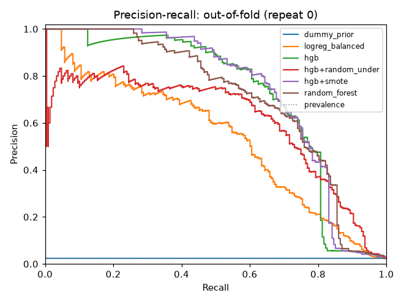
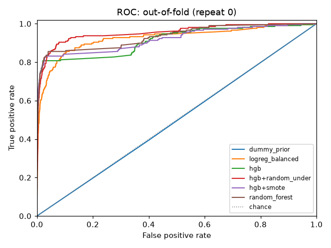
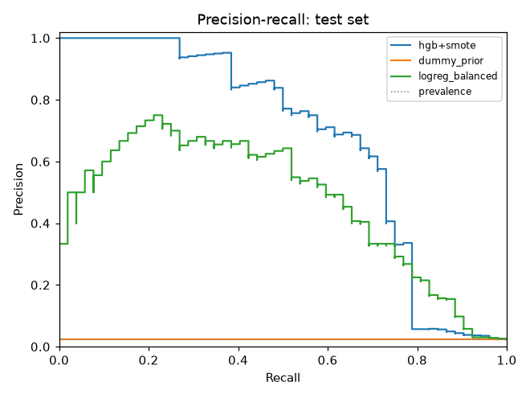
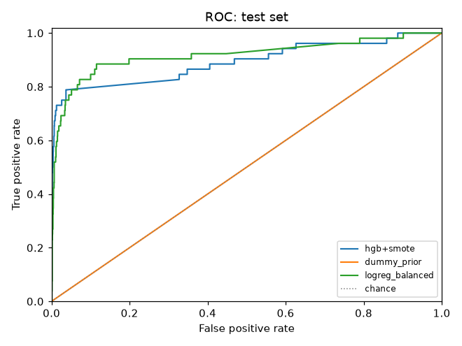

# ImbalanceLab audit report: run run-20261022T091904Z-596af186

## 1. Verdict

- Best candidate by mean out-of-fold AP: **hgb+smote** (selected on OOF predictions only; the test set was not used for selection).
- **hgb** beats **dummy_prior** on out-of-fold average precision: mean paired difference +0.6942, better in 15 of 15 folds (win fraction 1.00).
- **hgb** beats **logreg_balanced** on out-of-fold average precision: mean paired difference +0.1747, better in 15 of 15 folds (win fraction 1.00).
- **hgb+random_under** beats **dummy_prior** on out-of-fold average precision: mean paired difference +0.5843, better in 15 of 15 folds (win fraction 1.00).
- **hgb+random_under** beats **logreg_balanced** on out-of-fold average precision: mean paired difference +0.0648, better in 12 of 15 folds (win fraction 0.80).
- **hgb+smote** beats **dummy_prior** on out-of-fold average precision: mean paired difference +0.7217, better in 15 of 15 folds (win fraction 1.00).
- **hgb+smote** beats **logreg_balanced** on out-of-fold average precision: mean paired difference +0.2022, better in 15 of 15 folds (win fraction 1.00).
- **random_forest** beats **dummy_prior** on out-of-fold average precision: mean paired difference +0.6862, better in 15 of 15 folds (win fraction 1.00).
- **random_forest** beats **logreg_balanced** on out-of-fold average precision: mean paired difference +0.1667, better in 14 of 15 folds (win fraction 0.93).
- **logreg_balanced** beats **dummy_prior** on out-of-fold average precision: mean paired difference +0.5195, better in 15 of 15 folds (win fraction 1.00).
- **hgb+smote** beats **dummy_prior** on the test set (average_precision: 0.6670 vs 0.0232, difference +0.6438; single evaluation, no spread).
- **hgb+smote** beats **logreg_balanced** on the test set (average_precision: 0.6670 vs 0.4669, difference +0.2001; single evaluation, no spread).

Comparisons use paired differences on identical stored folds. CV folds are correlated, so no significance test is reported; win fractions and spreads are descriptive.

## 2. Dataset

| Field | Value |
|---|---|
| Source file | mammography.csv |
| SHA-256 | `eaed6c1612644fd5db935ca74257792ec473e64cd3925161e6030bdaf144e0ed` |
| Rows | 11183 |
| Target / positive label | `target` / `1` |
| Positives / negatives | 260 / 10923 |
| Positive rate | 0.0232 |
| Imbalance ratio (neg:pos) | 42.01 |
| Feature columns | 6 |
| Split strategy (schema) | stratified |

Features used: 6 numeric, 0 categorical.

## 3. Data profile warnings

These are **heuristic suspicions with the triggering statistic**, not proof of a problem. Each needs domain review.

| Code | Column | Severity | Message |
|---|---|---|---|
| exact_duplicates | — | warning | 3334 row(s) duplicate an earlier row; duplicates crossing split boundaries can inflate scores. |
| conflicting_duplicates | — | warning | 1 group(s) of rows have identical features but different labels (possible label noise). |

Duplicates: 3334 exact duplicate rows; 1 conflicting-label groups (3329 rows).

## 4. Split strategy

| Field | Value |
|---|---|
| Outer holdout strategy | stratified |
| Test size (config) | 0.20 |
| Outer-train rows / test rows / gap rows | 8946 / 2237 / 0 |
| Test indices SHA-256 | `ee4a3c8a3d3efbbfac7e1c20ba4c7fae2c3d9cec55bdd2101aed8a75a2a271c7` |
| Inner CV strategy | stratified |
| Folds × repeats | 5 × 3 (15 folds) |
| Fold indices SHA-256 | `273eb075663b91f47cad5b3600106b2b8617408cc133e221ca2f251fcb6da372` |
| Duplicate-aware groups | off |
| Oversized groups pinned to training (test / CV) | 0 groups, 0 rows / 0 groups, 0 rows |

CV, model selection and threshold selection use outer-train rows only. All models were fit on identical stored folds.

- `cross_boundary_duplicates` (warning): 632 test row(s) exactly duplicate outer-train feature rows, and 15 CV fold(s) have validation rows duplicating their training rows (max 581). Scores on duplicated rows may be optimistic.

## 5. Models

| Name | Role | Sampler | Estimator |
|---|---|---|---|
| dummy_prior | baseline | none | DummyClassifier(strategy='prior'): predicts the training prevalence |
| logreg_balanced | baseline | none | LogisticRegression(class_weight='balanced', max_iter=2000) |
| hgb | candidate | none | HistGradientBoostingClassifier(max_iter=200, learning_rate=0.1, early_stopping=False) |
| hgb+random_under | candidate | random_under | HistGradientBoostingClassifier(max_iter=200, learning_rate=0.1, early_stopping=False) |
| hgb+smote | candidate | smote | HistGradientBoostingClassifier(max_iter=200, learning_rate=0.1, early_stopping=False) |
| random_forest | candidate | none | RandomForestClassifier(n_estimators=300, min_samples_leaf=2, class_weight='balanced_subsample') |

## 6. Cross-validation results (out-of-fold)

Mean ± sample std across folds. `@ref` metrics use the fixed reference threshold 0.50, not a tuned threshold.

| Model | AP (primary) | ROC AUC | Brier ↓ | Precision@ref | Recall@ref | F1@ref |
|---|---|---|---|---|---|---|
| dummy_prior | 0.0233 ± 0.0003 (n=15) | 0.5000 ± 0.0000 (n=15) | 0.0227 ± 0.0003 (n=15) | undefined (0/15 folds defined) | 0.0000 ± 0.0000 (n=15) | 0.0000 ± 0.0000 (n=15) |
| logreg_balanced | 0.5427 ± 0.0783 (n=15) | 0.9268 ± 0.0240 (n=15) | 0.0829 ± 0.0041 (n=15) | 0.1651 ± 0.0100 (n=15) | 0.8447 ± 0.0376 (n=15) | 0.2761 ± 0.0142 (n=15) |
| hgb | 0.7175 ± 0.0541 (n=15) | 0.9144 ± 0.0209 (n=15) | 0.0111 ± 0.0020 (n=15) | 0.8198 ± 0.0792 (n=15) | 0.5818 ± 0.0676 (n=15) | 0.6791 ± 0.0661 (n=15) |
| hgb+random_under | 0.6075 ± 0.0986 (n=15) | 0.9459 ± 0.0167 (n=15) | 0.0794 ± 0.0105 (n=15) | 0.1838 ± 0.0206 (n=15) | 0.8911 ± 0.0346 (n=15) | 0.3040 ± 0.0261 (n=15) |
| hgb+smote | 0.7449 ± 0.0362 (n=15) | 0.9230 ± 0.0231 (n=15) | 0.0152 ± 0.0014 (n=15) | 0.6017 ± 0.0549 (n=15) | 0.7596 ± 0.0438 (n=15) | 0.6694 ± 0.0338 (n=15) |
| random_forest | 0.7094 ± 0.0707 (n=15) | 0.9310 ± 0.0156 (n=15) | 0.0126 ± 0.0016 (n=15) | 0.7681 ± 0.0960 (n=15) | 0.5578 ± 0.1029 (n=15) | 0.6431 ± 0.0932 (n=15) |

### Paired comparisons against baselines

| Candidate | Baseline | Metric | Pairs | Mean diff | Std diff | W/L/T | Win fraction |
|---|---|---|---|---|---|---|---|
| hgb | dummy_prior | average_precision | 15 | +0.6942 | 0.0541 | 15/0/0 | 1.00 |
| hgb | dummy_prior | roc_auc | 15 | +0.4144 | 0.0209 | 15/0/0 | 1.00 |
| hgb | logreg_balanced | average_precision | 15 | +0.1747 | 0.0856 | 15/0/0 | 1.00 |
| hgb | logreg_balanced | roc_auc | 15 | -0.0124 | 0.0192 | 5/10/0 | 0.33 |
| hgb+random_under | dummy_prior | average_precision | 15 | +0.5843 | 0.0985 | 15/0/0 | 1.00 |
| hgb+random_under | dummy_prior | roc_auc | 15 | +0.4459 | 0.0167 | 15/0/0 | 1.00 |
| hgb+random_under | logreg_balanced | average_precision | 15 | +0.0648 | 0.0932 | 12/3/0 | 0.80 |
| hgb+random_under | logreg_balanced | roc_auc | 15 | +0.0190 | 0.0216 | 13/2/0 | 0.87 |
| hgb+smote | dummy_prior | average_precision | 15 | +0.7217 | 0.0362 | 15/0/0 | 1.00 |
| hgb+smote | dummy_prior | roc_auc | 15 | +0.4230 | 0.0231 | 15/0/0 | 1.00 |
| hgb+smote | logreg_balanced | average_precision | 15 | +0.2022 | 0.0753 | 15/0/0 | 1.00 |
| hgb+smote | logreg_balanced | roc_auc | 15 | -0.0038 | 0.0331 | 8/7/0 | 0.53 |
| random_forest | dummy_prior | average_precision | 15 | +0.6862 | 0.0706 | 15/0/0 | 1.00 |
| random_forest | dummy_prior | roc_auc | 15 | +0.4310 | 0.0156 | 15/0/0 | 1.00 |
| random_forest | logreg_balanced | average_precision | 15 | +0.1667 | 0.0911 | 14/1/0 | 0.93 |
| random_forest | logreg_balanced | roc_auc | 15 | +0.0042 | 0.0219 | 10/5/0 | 0.67 |
| logreg_balanced | dummy_prior | average_precision | 15 | +0.5195 | 0.0783 | 15/0/0 | 1.00 |
| logreg_balanced | dummy_prior | roc_auc | 15 | +0.4268 | 0.0240 | 15/0/0 | 1.00 |





## 7. Threshold analysis (out-of-fold predictions only)

| Model | Strategy | Chosen (median) | Per-repeat threshold mean ± std [min, max] | Precision | Recall | F-beta | Repeats |
|---|---|---|---|---|---|---|---|
| hgb+smote | max_fbeta (beta 2.0) | 0.4292 | 0.4664 ± 0.0790 [0.4129, 0.5571] | 0.5882 | 0.7724 | 0.7262 | 3 |
| dummy_prior | max_fbeta (beta 2.0) | 0.0232 | 0.0232 ± 0.0000 [0.0232, 0.0232] | 0.0233 | 1.0000 | 0.1064 | 3 |
| logreg_balanced | max_fbeta (beta 2.0) | 0.8173 | 0.8282 ± 0.0207 [0.8151, 0.8521] | 0.4169 | 0.6554 | 0.5875 | 3 |

Precision, recall and F-beta are per-repeat means at each repeat's own selected threshold, which is optimistic because selection and measurement use the same OOF predictions.

## 8. Final test evaluation

Model **hgb+smote** refit on 8946 outer-train rows and scored once on 2237 test rows (52 positive) at threshold 0.4292 (selected on out-of-fold predictions, strategy `max_fbeta`). Evaluated at 2026-10-22T09:20:02.458900Z.

| Model | Threshold | AP | ROC AUC | Brier ↓ | Precision | Recall | F-beta | MCC | TP/FP/FN/TN |
|---|---|---|---|---|---|---|---|---|---|
| hgb+smote | 0.4292 | 0.6670 | 0.8917 | 0.0172 | 0.5672 | 0.7308 | 0.6909 | 0.6343 | 38/29/14/2156 |
| dummy_prior | 0.0232 | 0.0232 | 0.5000 | 0.0227 | 0.0232 | 1.0000 | 0.1063 | undefined | 52/2185/0/0 |
| logreg_balanced | 0.8173 | 0.4669 | 0.9167 | 0.0860 | 0.3830 | 0.6923 | 0.5960 | 0.5000 | 36/58/16/2127 |





Final-evaluation log: 2 entries.

- 2026-10-22T09:20:02.458900Z: final_evaluation
- 2026-10-22T09:20:02.589570Z: model_persisted

## 9. Limitations

- CV folds share training data, so fold scores are correlated; spreads understate uncertainty and no significance claims are made.
- Profile warnings are heuristics; a flagged column is not proven leakage, and an unflagged column is not proven safe.
- Thresholds are selected on out-of-fold predictions; their OOF metrics are optimistic.
- Test results are a single evaluation per model with no spread.
- Split warnings were raised (section 4); affected scores may be optimistic.

## 10. Reproducibility

| Field | Value |
|---|---|
| Run ID | run-20261022T091904Z-596af186 |
| Created / finished | 2026-10-22T09:19:03.947744Z / 2026-10-22T09:20:00.970425Z |
| Seed | 42 |
| Dataset SHA-256 | `eaed6c1612644fd5db935ca74257792ec473e64cd3925161e6030bdaf144e0ed` |
| Fold indices SHA-256 | `273eb075663b91f47cad5b3600106b2b8617408cc133e221ca2f251fcb6da372` |
| Test indices SHA-256 | `ee4a3c8a3d3efbbfac7e1c20ba4c7fae2c3d9cec55bdd2101aed8a75a2a271c7` |
| Python / platform | 3.13.5 / Windows-11-10.0.26300-SP0 |
| imbalancelab | 0.1.0 |
| numpy | 2.5.4 |
| pandas | 3.0.6 |
| scikit-learn | 1.9.1 |
| imbalanced-learn | 0.14.2 |
| scipy | 1.18.1 |
| joblib | 1.6.0 |
| pyarrow | 26.0.0 |
| pydantic | 2.14.1 |
| matplotlib | 3.11.2 |

Experiment config (`config.json`):

```json
{
  "candidates": [
    {
      "model": "hgb",
      "sampler": "none"
    },
    {
      "model": "hgb",
      "sampler": "random_under"
    },
    {
      "model": "hgb",
      "sampler": "smote"
    },
    {
      "model": "random_forest",
      "sampler": "none"
    }
  ],
  "cv": {
    "n_splits": 5,
    "n_repeats": 3,
    "gap": 0,
    "seed": 42,
    "max_eval_group_fraction": 0.25
  },
  "seed": 42,
  "threshold": 0.5,
  "beta": 1.0,
  "smote_k_neighbors": 5
}
```
