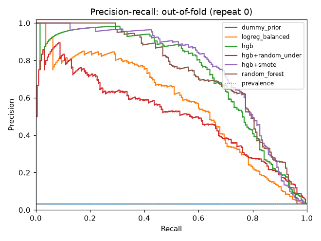
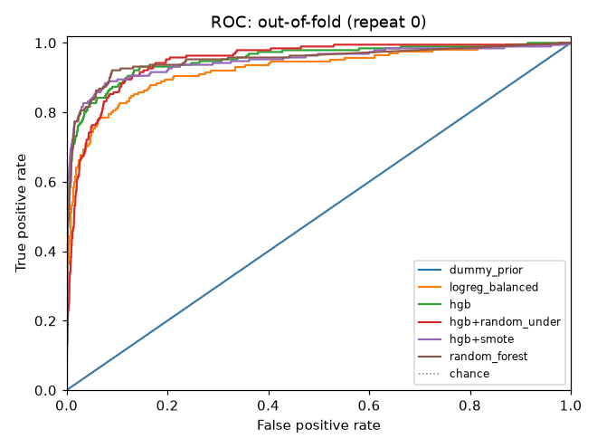
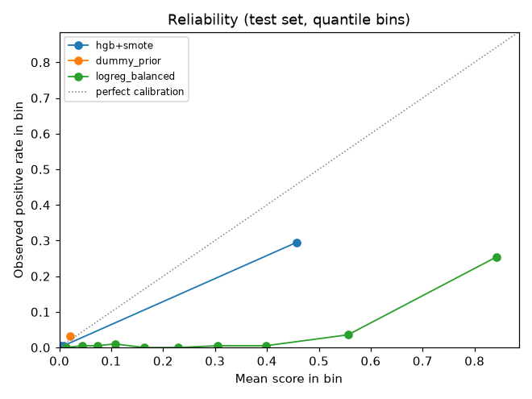
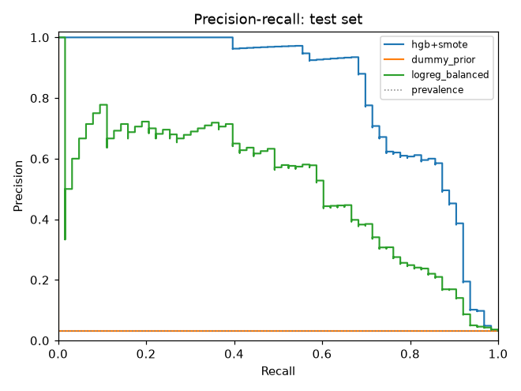
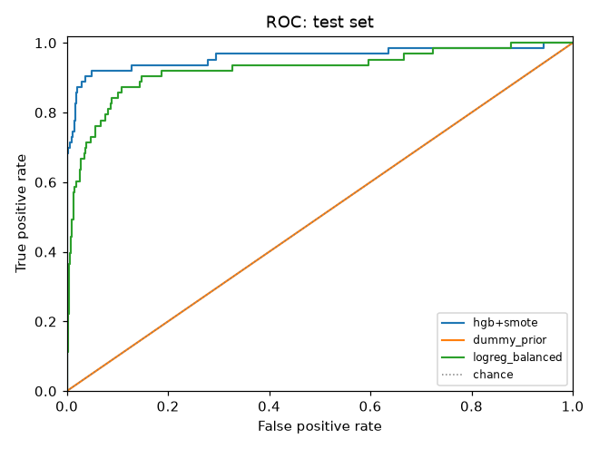

# ImbalanceLab audit report: run run-20261022T092013Z-2056207e

## 1. Verdict

- Best candidate by mean out-of-fold AP: **hgb+smote** (selected on OOF predictions only; the test set was not used for selection).
- **hgb** beats **dummy_prior** on out-of-fold average precision: mean paired difference +0.6972, better in 15 of 15 folds (win fraction 1.00).
- **hgb** beats **logreg_balanced** on out-of-fold average precision: mean paired difference +0.1614, better in 15 of 15 folds (win fraction 1.00).
- **hgb+random_under** beats **dummy_prior** on out-of-fold average precision: mean paired difference +0.5142, better in 15 of 15 folds (win fraction 1.00).
- **hgb+random_under** does NOT beat **logreg_balanced** on out-of-fold average precision: mean paired difference -0.0216, better in 6 of 15 folds (win fraction 0.40).
- **hgb+smote** beats **dummy_prior** on out-of-fold average precision: mean paired difference +0.7192, better in 15 of 15 folds (win fraction 1.00).
- **hgb+smote** beats **logreg_balanced** on out-of-fold average precision: mean paired difference +0.1834, better in 15 of 15 folds (win fraction 1.00).
- **random_forest** beats **dummy_prior** on out-of-fold average precision: mean paired difference +0.6969, better in 15 of 15 folds (win fraction 1.00).
- **random_forest** beats **logreg_balanced** on out-of-fold average precision: mean paired difference +0.1611, better in 15 of 15 folds (win fraction 1.00).
- **logreg_balanced** beats **dummy_prior** on out-of-fold average precision: mean paired difference +0.5358, better in 15 of 15 folds (win fraction 1.00).
- **hgb+smote** beats **dummy_prior** on the test set (average_precision: 0.8228 [0.7383, 0.8977] vs 0.0321 [0.0321, 0.0321] (95% CIs), point difference +0.7907; single evaluation).
- **hgb+smote** beats **logreg_balanced** on the test set (average_precision: 0.8228 [0.7383, 0.8977] vs 0.5023 [0.3926, 0.6442] (95% CIs), point difference +0.3205; single evaluation).

Comparisons use paired differences on identical stored folds. CV folds are correlated, so no significance test is reported; win fractions and spreads are descriptive.

## 2. Dataset

| Field | Value |
|---|---|
| Source file | mammography.csv |
| SHA-256 | `eaed6c1612644fd5db935ca74257792ec473e64cd3925161e6030bdaf144e0ed` |
| Rows | 11183 |
| Target / positive label | `target` / `1` |
| Positives / negatives | 260 / 10923 |
| Positive rate | 0.0232 |
| Imbalance ratio (neg:pos) | 42.01 |
| Feature columns | 6 |
| Split strategy (schema) | stratified |

Features used: 6 numeric, 0 categorical.

## 3. Data profile warnings

These are **heuristic suspicions with the triggering statistic**, not proof of a problem. Each needs domain review.

| Code | Column | Severity | Message |
|---|---|---|---|
| exact_duplicates | — | warning | 3334 row(s) duplicate an earlier row; duplicates crossing split boundaries can inflate scores. |
| conflicting_duplicates | — | warning | 1 group(s) of rows have identical features but different labels (possible label noise). |

Duplicates: 3334 exact duplicate rows; 1 conflicting-label groups (3329 rows).

## 4. Split strategy

| Field | Value |
|---|---|
| Outer holdout strategy | stratified |
| Test size (config) | 0.20 |
| Outer-train rows / test rows / gap rows | 9219 / 1964 / 0 |
| Test indices SHA-256 | `7ee8afda21eac8e55d32cec3c391e8d48d7034924747d626e357f536c5ebdd89` |
| Inner CV strategy | stratified |
| Folds × repeats | 5 × 3 (15 folds) |
| Fold indices SHA-256 | `f59d5586847fafdfbb5f7ea5f808783f63a2ac15f918acdf1c14aa3716e8ffd0` |
| Duplicate-aware groups | on: 7848 split groups (duplicates); 3 duplicate clusters covering 3338 rows; 1 with conflicting labels |
| Oversized groups pinned to training (test / CV) | 1 groups, 3329 rows / 1 groups, 3329 rows |

CV, model selection and threshold selection use outer-train rows only. All models were fit on identical stored folds.

- `conflicting_label_clusters` (info): 1 duplicate cluster(s) (3329 rows) have identical features but different labels; they are kept and split together.
- `oversized_groups_pinned_to_train` (warning): 1 group(s) covering 3329 rows exceed 559 rows (max_eval_group_fraction of the test set size) and are always on the training side; test set metrics do not cover these rows.
- `oversized_groups_pinned_to_train` (warning): 1 group(s) covering 3329 rows exceed 461 rows (max_eval_group_fraction of the validation fold size) and are always on the training side; validation fold metrics do not cover these rows.
- `evaluation_coverage_gap` (warning): 3329 rows (29.8% of the dataset, 7 positives) are never in any test or validation set (oversized groups forced to train). Results do not describe these rows.

## 5. Evaluation coverage

**WARNING:** 3329 rows (29.8% of the dataset, 7 positives) were never in any test or validation set. **The reported results do not describe these rows.**

| Field | Value |
|---|---|
| Rows / positives in dataset | 11183 / 260 |
| Rows evaluated (test or any validation fold) | 7854 |
| Forced to train, never evaluated: rows / positives | 3329 / 7 |
| Forced to train: % of rows / % of positives | 29.77% / 2.69% |
| Large-group cut-off | groups larger than 25% of the target test size (559 rows) or 25% of the target validation-fold size (461 rows) are forced to train |
| Forced-to-train groups | 1: 3329 rows (7 positive) |
| Temporal gap rows | 0 |
| Other never-evaluated rows | 0 (not in any test or validation fold) |
| Warning threshold | 10% of rows |

## 6. Models

| Name | Role | Sampler | Estimator |
|---|---|---|---|
| dummy_prior | baseline | none | DummyClassifier(strategy='prior'): predicts the training prevalence |
| logreg_balanced | baseline | none | LogisticRegression(class_weight='balanced', max_iter=2000) |
| hgb | candidate | none | HistGradientBoostingClassifier(max_iter=200, learning_rate=0.1, early_stopping=False) |
| hgb+random_under | candidate | random_under | HistGradientBoostingClassifier(max_iter=200, learning_rate=0.1, early_stopping=False) |
| hgb+smote | candidate | smote | HistGradientBoostingClassifier(max_iter=200, learning_rate=0.1, early_stopping=False) |
| random_forest | candidate | none | RandomForestClassifier(n_estimators=300, min_samples_leaf=2, class_weight='balanced_subsample') |

## 7. Cross-validation results (out-of-fold)

Mean ± sample std across folds. `@ref` metrics use the fixed reference threshold 0.50, not a tuned threshold.

| Model | AP (primary) | ROC AUC | Brier ↓ | Precision@ref | Recall@ref | F1@ref |
|---|---|---|---|---|---|---|
| dummy_prior | 0.0323 ± 0.0000 (n=15) | 0.5000 ± 0.0000 (n=15) | 0.0314 ± 0.0000 (n=15) | undefined (0/15 folds defined) | 0.0000 ± 0.0000 (n=15) | 0.0000 ± 0.0000 (n=15) |
| logreg_balanced | 0.5681 ± 0.0932 (n=15) | 0.9245 ± 0.0177 (n=15) | 0.1278 ± 0.0065 (n=15) | 0.1440 ± 0.0078 (n=15) | 0.8842 ± 0.0342 (n=15) | 0.2475 ± 0.0115 (n=15) |
| hgb | 0.7295 ± 0.0589 (n=15) | 0.9542 ± 0.0191 (n=15) | 0.0156 ± 0.0025 (n=15) | 0.8121 ± 0.0666 (n=15) | 0.5965 ± 0.0830 (n=15) | 0.6838 ± 0.0630 (n=15) |
| hgb+random_under | 0.5465 ± 0.0694 (n=15) | 0.9494 ± 0.0168 (n=15) | 0.1398 ± 0.0260 (n=15) | 0.1581 ± 0.0215 (n=15) | 0.9246 ± 0.0328 (n=15) | 0.2694 ± 0.0314 (n=15) |
| hgb+smote | 0.7515 ± 0.0611 (n=15) | 0.9540 ± 0.0200 (n=15) | 0.0219 ± 0.0033 (n=15) | 0.5653 ± 0.0651 (n=15) | 0.7596 ± 0.0636 (n=15) | 0.6467 ± 0.0558 (n=15) |
| random_forest | 0.7292 ± 0.0635 (n=15) | 0.9568 ± 0.0201 (n=15) | 0.0154 ± 0.0019 (n=15) | 0.7683 ± 0.0797 (n=15) | 0.5632 ± 0.0877 (n=15) | 0.6476 ± 0.0794 (n=15) |

### Paired comparisons against baselines

| Candidate | Baseline | Metric | Pairs | Mean diff | Std diff | W/L/T | Win fraction |
|---|---|---|---|---|---|---|---|
| hgb | dummy_prior | average_precision | 15 | +0.6972 | 0.0589 | 15/0/0 | 1.00 |
| hgb | dummy_prior | roc_auc | 15 | +0.4542 | 0.0191 | 15/0/0 | 1.00 |
| hgb | logreg_balanced | average_precision | 15 | +0.1614 | 0.0776 | 15/0/0 | 1.00 |
| hgb | logreg_balanced | roc_auc | 15 | +0.0297 | 0.0155 | 15/0/0 | 1.00 |
| hgb+random_under | dummy_prior | average_precision | 15 | +0.5142 | 0.0694 | 15/0/0 | 1.00 |
| hgb+random_under | dummy_prior | roc_auc | 15 | +0.4494 | 0.0168 | 15/0/0 | 1.00 |
| hgb+random_under | logreg_balanced | average_precision | 15 | -0.0216 | 0.1144 | 6/9/0 | 0.40 |
| hgb+random_under | logreg_balanced | roc_auc | 15 | +0.0249 | 0.0190 | 14/1/0 | 0.93 |
| hgb+smote | dummy_prior | average_precision | 15 | +0.7192 | 0.0611 | 15/0/0 | 1.00 |
| hgb+smote | dummy_prior | roc_auc | 15 | +0.4540 | 0.0200 | 15/0/0 | 1.00 |
| hgb+smote | logreg_balanced | average_precision | 15 | +0.1834 | 0.0744 | 15/0/0 | 1.00 |
| hgb+smote | logreg_balanced | roc_auc | 15 | +0.0295 | 0.0130 | 15/0/0 | 1.00 |
| random_forest | dummy_prior | average_precision | 15 | +0.6969 | 0.0635 | 15/0/0 | 1.00 |
| random_forest | dummy_prior | roc_auc | 15 | +0.4568 | 0.0201 | 15/0/0 | 1.00 |
| random_forest | logreg_balanced | average_precision | 15 | +0.1611 | 0.0912 | 15/0/0 | 1.00 |
| random_forest | logreg_balanced | roc_auc | 15 | +0.0323 | 0.0144 | 15/0/0 | 1.00 |
| logreg_balanced | dummy_prior | average_precision | 15 | +0.5358 | 0.0932 | 15/0/0 | 1.00 |
| logreg_balanced | dummy_prior | roc_auc | 15 | +0.4245 | 0.0177 | 15/0/0 | 1.00 |





## 8. Threshold analysis (out-of-fold predictions only)

| Model | Strategy | Chosen (median) | Per-repeat threshold mean ± std [min, max] | Precision | Recall | F-beta | Repeats |
|---|---|---|---|---|---|---|---|
| hgb+smote | max_fbeta (beta 2.0) | 0.6036 | 0.6001 ± 0.0814 [0.5170, 0.6796] | 0.6005 | 0.7526 | 0.7162 | 3 |
| dummy_prior | max_fbeta (beta 2.0) | 0.0198 | 0.0198 ± 0.0000 [0.0198, 0.0198] | 0.0323 | 1.0000 | 0.1429 | 3 |
| logreg_balanced | max_fbeta (beta 2.0) | 0.8605 | 0.8592 ± 0.0295 [0.8291, 0.8880] | 0.4586 | 0.6702 | 0.6111 | 3 |

Precision, recall and F-beta are per-repeat means at each repeat's own selected threshold, which is optimistic because selection and measurement use the same OOF predictions.

## 9. Final test evaluation

Model **hgb+smote** refit on 9219 outer-train rows and scored once on 1964 test rows (63 positive) at threshold 0.6036 (selected on out-of-fold predictions, strategy `max_fbeta`). Evaluated at 2026-10-22T09:21:15.405438Z.

| Model | Threshold | AP | ROC AUC | Brier ↓ | Precision | Recall | F-beta | MCC | TP/FP/FN/TN |
|---|---|---|---|---|---|---|---|---|---|
| hgb+smote | 0.6036 | 0.8228 [0.7383, 0.8977] | 0.9589 [0.9180, 0.9889] | 0.0181 [0.0135, 0.0231] | 0.6049 [0.5238, 0.7000] | 0.7778 [0.6667, 0.8730] | 0.7357 [0.6476, 0.8187] | 0.6743 [0.5930, 0.7531] | 49/32/14/1869 |
| dummy_prior | 0.0198 | 0.0321 [0.0321, 0.0321] | 0.5000 [0.5000, 0.5000] | 0.0312 [0.0312, 0.0312] | 0.0321 [0.0321, 0.0321] | 1.0000 [1.0000, 1.0000] | 0.1421 [0.1421, 0.1421] | undefined [CI undefined] | 63/1901/0/0 |
| logreg_balanced | 0.8605 | 0.5023 [0.3926, 0.6442] | 0.9225 [0.8764, 0.9611] | 0.1182 [0.1101, 0.1267] | 0.4419 [0.3608, 0.5334] | 0.6032 [0.4762, 0.7147] | 0.5621 [0.4559, 0.6595] | 0.4977 [0.4047, 0.5920] | 38/48/25/1853 |

Brackets: 95% CI from a stratified bootstrap (positives and negatives resampled separately), percentile interval, 2000 resamples, seed 42, computed from the stored test predictions. Undefined resamples are counted in the bracket; Brier has no CI.

### Paired bootstrap of test differences (selected model − baseline)

| Candidate | Baseline | Metric | Difference [95% CI] | Win fraction | Undefined resamples |
|---|---|---|---|---|---|
| hgb+smote | dummy_prior | average_precision | +0.7907 [+0.7062, +0.8657] | 1.000 | 0 |
| hgb+smote | dummy_prior | roc_auc | +0.4589 [+0.4180, +0.4889] | 1.000 | 0 |
| hgb+smote | logreg_balanced | average_precision | +0.3205 [+0.2078, +0.4115] | 1.000 | 0 |
| hgb+smote | logreg_balanced | roc_auc | +0.0364 [-0.0025, +0.0791] | 0.962 | 0 |

Both models are scored on the same resampled test rows, so the interval is for the difference itself. Win fraction is the share of resamples where the selected model is strictly better. This is descriptive and is not a significance test.

### Calibration (disclosure only; no calibration stage)

- **Scores from models trained with a resampler (`hgb+random_under`, `hgb+smote`) are ranking scores, NOT calibrated probabilities. Resampling changes the class balance seen during training, so these scores do not estimate the probability of the positive class. Do not interpret them as risk.**
- **Class-weighted models (`logreg_balanced`, `random_forest`) also shift scores away from the training prevalence.**

Test Brier score (hgb+smote): 0.0181 [0.0135, 0.0231] (lower is better). Reliability bins for the selected model (quantile bins of its test scores; n per bin shown):

| Bin | Score range | n | Positives | Mean score | Observed rate |
|---|---|---|---|---|---|
| 1 | [0.0000, 0.0000] | 197 | 1 | 0.0000 | 0.0051 |
| 2 | [0.0000, 0.0001] | 196 | 0 | 0.0000 | 0.0000 |
| 3 | [0.0001, 0.0001] | 196 | 0 | 0.0001 | 0.0000 |
| 4 | [0.0001, 0.0002] | 197 | 1 | 0.0002 | 0.0051 |
| 5 | [0.0002, 0.0003] | 196 | 0 | 0.0003 | 0.0000 |
| 6 | [0.0003, 0.0006] | 196 | 0 | 0.0004 | 0.0000 |
| 7 | [0.0006, 0.0011] | 197 | 1 | 0.0008 | 0.0051 |
| 8 | [0.0011, 0.0034] | 196 | 1 | 0.0020 | 0.0051 |
| 9 | [0.0034, 0.0229] | 196 | 1 | 0.0082 | 0.0051 |
| 10 | [0.0229, 1.0000] | 197 | 58 | 0.4565 | 0.2944 |







### Test-scoring history

Test set scored **1 time** for this run (count of `final_evaluation` events in `final_evaluation_log.jsonl`).

| # | Time | Model | Forced |
|---|---|---|---|
| 1 | 2026-10-22T09:21:15.405438Z | hgb+smote | no |

Forced re-evaluations: none.

Amendments (**no test scoring**):

| Time | What |
|---|---|
| 2026-10-22T09:21:15.533441Z | model persisted (model-20261022T092115Z-819a6e87) |
| 2026-10-22T10:04:28.879800Z | added evaluation_coverage computed from stored holdout + rebuilt folds (fold-index SHA-256 verified); nothing refit or scored [run.json] |
| 2026-10-22T10:04:30.637958Z | added bootstrap CIs computed from stored final_predictions.parquet (no refit, no re-scoring) [final_evaluation.json] |
| 2026-10-22T14:41:12.545544Z | added evaluation_coverage computed from stored holdout + rebuilt folds (fold-index SHA-256 verified); nothing refit or scored [run.json] |
| 2026-10-22T14:41:27.728707Z | added bootstrap CIs (incl. Brier), reliability curves and paired bootstrap differences computed from stored final_predictions.parquet (no refit, no re-scoring) [final_evaluation.json] |

## 10. Limitations

- CV folds share training data, so fold scores are correlated; spreads understate uncertainty and no significance claims are made.
- Profile warnings are heuristics; a flagged column is not proven leakage, and an unflagged column is not proven safe.
- Thresholds are selected on out-of-fold predictions; their OOF metrics are optimistic.
- Test results are a single evaluation per model; bootstrap CIs reflect test-sample variation only, not model-training variation.
- Scores are not calibrated (no calibration stage); see the calibration disclosure in section 9.
- Thresholds are selected on out-of-fold scores of the fold models and then applied to the model refit on all outer-train rows, whose score distribution may differ (notably with SMOTE). Test CIs at the threshold hold the threshold fixed and do not include threshold-selection uncertainty.
- Split warnings were raised (section 4); affected scores may be optimistic.
- 3329 rows in oversized groups were never evaluated (section 5).

## 11. Reproducibility

| Field | Value |
|---|---|
| Run ID | run-20261022T092013Z-2056207e |
| Created / finished | 2026-10-22T09:20:08.347222Z / 2026-10-22T09:21:14.289357Z |
| Seed | 42 |
| Dataset SHA-256 | `eaed6c1612644fd5db935ca74257792ec473e64cd3925161e6030bdaf144e0ed` |
| Fold indices SHA-256 | `f59d5586847fafdfbb5f7ea5f808783f63a2ac15f918acdf1c14aa3716e8ffd0` |
| Test indices SHA-256 | `7ee8afda21eac8e55d32cec3c391e8d48d7034924747d626e357f536c5ebdd89` |
| Python / platform | 3.13.5 / Windows-11-10.0.26300-SP0 |
| imbalancelab | 0.1.0 |
| numpy | 2.5.4 |
| pandas | 3.0.6 |
| scikit-learn | 1.9.1 |
| imbalanced-learn | 0.14.2 |
| scipy | 1.18.1 |
| joblib | 1.6.0 |
| pyarrow | 26.0.0 |
| pydantic | 2.14.1 |
| matplotlib | 3.11.2 |

Experiment config (`config.json`):

```json
{
  "candidates": [
    {
      "model": "hgb",
      "sampler": "none"
    },
    {
      "model": "hgb",
      "sampler": "random_under"
    },
    {
      "model": "hgb",
      "sampler": "smote"
    },
    {
      "model": "random_forest",
      "sampler": "none"
    }
  ],
  "cv": {
    "n_splits": 5,
    "n_repeats": 3,
    "gap": 0,
    "seed": 42,
    "max_eval_group_fraction": 0.25
  },
  "seed": 42,
  "threshold": 0.5,
  "beta": 1.0,
  "smote_k_neighbors": 5
}
```
